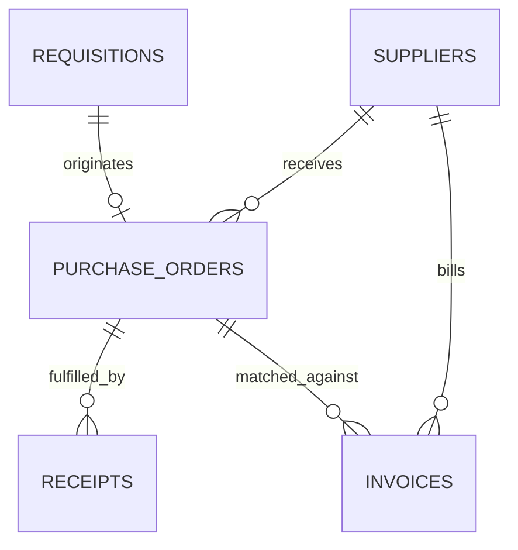

# Data Dictionary: Northstar Manufacturing Ltd. (P2P Case Study)

This document provides complete structural, referential, and business rule definitions for the synthetic datasets in the `data/` directory.

> **Disclaimer**: All datasets, identifiers, supplier entities, and transactional volumes in this project are entirely synthetic and created for academic, project-management, and business-analysis portfolio demonstration.

---

## Entity Relationship Overview

---

## 1. Suppliers Table (`suppliers.csv`)
Master record of approved vendors supplying Northstar Manufacturing Ltd.

| Field Name | Data Type | Nullable | Primary / Foreign Key | Description & Validation Rules |
| :--- | :--- | :--- | :--- | :--- |
| `supplier_id` | String (VARCHAR) | No | Primary Key | Unique vendor identifier format `SUP-###` (e.g., `SUP-001`). |
| `supplier_name` | String (VARCHAR) | No | None | Legal operating name of the synthetic commercial vendor. |
| `category` | String (VARCHAR) | No | None | Primary spend category: `Raw Materials`, `MRO & Tooling`, `Packaging`, `Facilities & Services`, `Logistics`, `IT & Telecommunications`. |
| `payment_terms` | String (VARCHAR) | No | None | Standard contractual payment terms: `Net 30`, `Net 45`, `Net 60`, `2/10 Net 30`. |
| `risk_rating` | String (VARCHAR) | No | None | Supplier financial & supply chain risk classification: `Low`, `Medium`, `High`. |
| `lead_time_days`| Integer | No | None | Average order lead time in calendar days (5–30 days). |
| `is_active` | Boolean | No | None | System status indicator (True/False). |
| `created_date` | Date (YYYY-MM-DD)| No | None | Master record activation date. |

---

## 2. Purchase Requisitions Table (`requisitions.csv`)
Internal requests generated by operational departments requesting goods or services.

| Field Name | Data Type | Nullable | Primary / Foreign Key | Description & Validation Rules |
| :--- | :--- | :--- | :--- | :--- |
| `pr_id` | String (VARCHAR) | No | Primary Key | Unique purchase requisition identifier format `PR-#####`. |
| `pr_date` | Date (YYYY-MM-DD)| No | None | Date requisition was logged by user. |
| `department` | String (VARCHAR) | No | None | Originating cost center / operating department. |
| `requester_name`| String (VARCHAR) | No | None | Synthetic employee submitting request. |
| `category` | String (VARCHAR) | No | None | Procurement spend classification. |
| `estimated_amount`| Decimal (12,2) | No | None | Estimated requisition total value in USD. Must be > 0. |
| `approval_status`| String (VARCHAR) | No | None | Workflow routing status: `Approved`, `Rejected`, `Pending Approval`. |
| `approver` | String (VARCHAR) | Yes | None | Role assigned to approve based on Delegation of Authority (DoA) limits. |
| `approval_date` | Date (YYYY-MM-DD)| Yes | None | Date approval was recorded. Null if pending. |
| `justification` | String (VARCHAR) | No | None | Business rationale and project cost justification. |

---

## 3. Purchase Orders Table (`purchase_orders.csv`)
Legally binding commercial orders issued to approved vendors based on approved PRs.

| Field Name | Data Type | Nullable | Primary / Foreign Key | Description & Validation Rules |
| :--- | :--- | :--- | :--- | :--- |
| `po_id` | String (VARCHAR) | No | Primary Key | Unique purchase order identifier format `PO-#####`. |
| `pr_id` | String (VARCHAR) | No | Foreign Key | References parent `requisitions.pr_id`. |
| `supplier_id` | String (VARCHAR) | No | Foreign Key | References `suppliers.supplier_id`. |
| `supplier_name` | String (VARCHAR) | No | None | Vendor name denormalized for operational indexing. |
| `category` | String (VARCHAR) | No | None | Commodity classification matching PR. |
| `buyer_name` | String (VARCHAR) | No | None | Named procurement specialist who reviewed and dispatched PO. |
| `po_date` | Date (YYYY-MM-DD)| No | None | Date PO was executed and transmitted to supplier. |
| `po_amount` | Decimal (12,2) | No | None | Total committed value of the purchase order in USD. |
| `line_count` | Integer | No | None | Count of discrete line items on the purchase order. |
| `payment_terms` | String (VARCHAR) | No | None | Contractual terms negotiated on the purchase order. |
| `matching_type` | String (VARCHAR) | No | None | Validation rule: `3-Way Match` (goods) or `2-Way Match` (services). |
| `lead_time_days`| Integer | No | None | Expected delivery lead time in days. |
| `po_status` | String (VARCHAR) | No | None | Lifecycle state: `Open - Awaiting Delivery`, `Received - Pending Invoice`, `Invoiced - Pending Payment`, `Closed`. |

---

## 4. Goods Receipts Table (`receipts.csv`)
Dock receiving log recording physical shipment delivery and warehouse intake.

| Field Name | Data Type | Nullable | Primary / Foreign Key | Description & Validation Rules |
| :--- | :--- | :--- | :--- | :--- |
| `receipt_id` | String (VARCHAR) | No | Primary Key | Unique receiving slip identifier format `REC-#####`. |
| `po_id` | String (VARCHAR) | No | Foreign Key | References `purchase_orders.po_id`. |
| `supplier_id` | String (VARCHAR) | No | Foreign Key | References `suppliers.supplier_id`. |
| `receipt_date` | Date (YYYY-MM-DD)| No | None | Date shipment was logged at receiving dock. |
| `receiving_clerk`| String (VARCHAR) | No | None | Warehouse dock clerk logging the shipment. |
| `received_qty_pct`| Decimal (5,2) | No | None | Percentage of ordered quantity physically received (e.g. 100%, 80%). |
| `inspection_status`| String (VARCHAR) | No | None | Receiving QA condition: `Accepted Full`, `Partial Delivery Received`, `Damaged in Transit / Return Recorded`. |
| `dock_location` | String (VARCHAR) | No | None | Physical warehouse dock staging area. |

---

## 5. Invoices Table (`invoices.csv`)
Accounts Payable liability records entered upon receipt of vendor billing.

| Field Name | Data Type | Nullable | Primary / Foreign Key | Description & Validation Rules |
| :--- | :--- | :--- | :--- | :--- |
| `invoice_id` | String (VARCHAR) | No | Primary Key | Internal AP voucher identifier format `INV-#####`. |
| `po_id` | String (VARCHAR) | No | Foreign Key | References `purchase_orders.po_id`. |
| `supplier_id` | String (VARCHAR) | No | Foreign Key | References `suppliers.supplier_id`. |
| `supplier_name` | String (VARCHAR) | No | None | Vendor legal billing name. |
| `supplier_invoice_ref`| String (VARCHAR) | No | None | Vendor's external invoice reference number. |
| `invoice_date` | Date (YYYY-MM-DD)| No | None | Invoice document date indicated by supplier. |
| `due_date` | Date (YYYY-MM-DD)| No | None | Contractual payment due date calculated from payment terms. |
| `invoice_amount`| Decimal (12,2) | No | None | Total billed amount payable to vendor. |
| `po_amount` | Decimal (12,2) | No | None | Original PO commitment amount for variance comparison. |
| `variance_amount`| Decimal (12,2)| No | None | Difference (`invoice_amount` - `po_amount`). |
| `matching_type` | String (VARCHAR) | No | None | Matching protocol: `3-Way Match` or `2-Way Match`. |
| `match_status` | String (VARCHAR) | No | None | Validation status: `Matched`, `Matched (Within Tolerance)`, `Hold: Price Variance`, `Hold: Missing Goods Receipt`, `Hold: Quantity Variance`. |
| `hold_reason` | String (VARCHAR) | No | None | Root cause explanation for hold or auto-match verification. |
| `hold_resolution`| String (VARCHAR)| No | None | Exception resolution action or workflow disposition. |
| `payment_status`| String (VARCHAR) | No | None | Settlement state: `Paid`, `Approved for Payment`, `On Hold`. |
| `paid_date` | Date (YYYY-MM-DD)| Yes | None | Disbursement execution date. Null if unpaid or on hold. |
| `payment_reference`| String (VARCHAR)| Yes | None | Banking settlement trace reference (e.g. `ACH-######`, `EFT-######`). |

---

## Referential Integrity Rules & Automated Validation

The Python analysis suite enforces the following constraints across all datasets:
1. **Primary Key Uniqueness**: `COUNT(DISTINCT id) == COUNT(id)` for all entities.
2. **Referential Integrity**:
   - $PO_{pr\_id} \subseteq REQUISITION_{pr\_id}$
   - $PO_{supplier\_id} \subseteq SUPPLIER_{supplier\_id}$
   - $RECEIPT_{po\_id} \subseteq PO_{po\_id}$
   - $INVOICE_{po\_id} \subseteq PO_{po\_id}$
   - $INVOICE_{supplier\_id} \subseteq SUPPLIER_{supplier\_id}$
3. **Temporal Validity**:
   - $PR_{date} \le PR_{approval\_date} \le PO_{date}$
   - For standard 3-Way flows: $PO_{date} \le RECEIPT_{date}$
   - Invoices arriving prior to receipt automatically trigger `Hold: Missing Goods Receipt`.
4. **Tolerance Controls**:
   - Invoices with price variances $\le 1.5\%$ or $\le \$50$ match automatically under configured tolerance limits.
   - Price variances $> 2\%$ trigger `Hold: Price Variance` requiring manual supervisory review.
