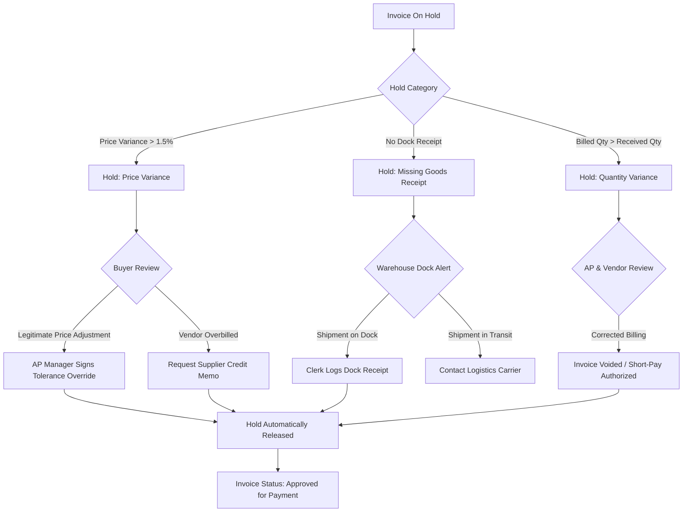

# Functional Design Document (FDD): Procure-to-Pay Solution

**Client Organization**: Northstar Manufacturing Ltd. (Fictional Enterprise)  
**Process Area**: Procure-to-Pay (P2P)  
**Document Reference**: FDD-P2P-001  
**Status**: Baseline Conceptual Architecture

> **Simulated Project Disclaimer**:  
> This functional design document represents an independent simulated design aligned conceptually with Oracle Fusion Cloud Procurement and Financials. It reflects industry-standard ERP principles, controls, and workflows. Live Oracle screen paths, menu options, Web Services, REST APIs, and specific setup tasks must be verified against current official Oracle documentation and the licensed enterprise environment.

---

## 1. Solution Architecture & Module Alignment

The proposed future-state P2P solution is structured across five conceptual functional modules within modern enterprise cloud ERP:
1. **Self-Service Procurement**: Employee portal for catalog requisitioning, non-catalog requests, and approval status tracking.
2. **Purchasing & Blanket Agreements**: Buyer workbench for managing Blanket Purchase Agreements (BPAs), converting requisitions to POs, and managing vendor communications.
3. **Receiving & Inventory Inspection**: Warehouse dock workbench for receiving physical shipments against PO lines and tracking inspection dispositions.
4. **Payables (Financials)**: Invoice capture, 2-Way and 3-Way matching engine, hold management, and automated payment batch generation.
5. **General Ledger & Subledger Accounting (SLA)**: Automated accounting rule generation for encumbrances, accruals at receipt, accounts payable liabilities, and cash clearing.

---

## 2. Business Roles & Security Profiles (RBAC / SoD)

To enforce strict Segregation of Duties (SoD) and internal control compliance (SOX-aligned), system permissions are partitioned into discrete role profiles:

| Role Name | Primary Responsibilities | Permitted System Actions | Explicit Control Restrictions |
| :--- | :--- | :--- | :--- |
| **Requisitioner** | Plant & operational staff | Browse catalogs, create PRs, view personal request status. | Cannot approve PRs; cannot issue POs; cannot approve invoices. |
| **Department Manager / Director** | Operational cost-center owners | Approve/reject requisitions within assigned DoA limits. | Cannot create PRs that route to themselves; cannot create POs or release payments. |
| **Procurement Buyer** | Purchasing team | Manage supplier catalogs, review non-catalog PRs, issue POs, negotiate terms. | Cannot enter goods receipts; cannot enter invoices; cannot approve payments. |
| **Receiving Clerk** | Warehouse dock personnel | Query open PO lines, record received quantities, log damage dispositions. | Cannot view invoice data; cannot create POs; cannot approve vendor payments. |
| **Accounts Payable Specialist** | Finance / AP staff | Enter/verify supplier invoices, investigate matching holds, apply credit memos. | Cannot create or approve POs; cannot record receiving dock receipts; cannot sign off payment batches. |
| **Accounts Payable Manager** | Finance leadership | Authorize invoice price overrides above tolerance, approve payment batches. | Cannot originate vendor invoices; cannot edit vendor master banking details. |
| **Chief Financial Officer (CFO)** | Executive leadership | Review enterprise spend dashboards, authorize high-value disbursements ($>\$25\text{k}$). | View-only access to transaction entries; final approval authority on major expenditures. |

---

## 3. Key Business Rules & System Logic

### 3.1 Delegation of Authority (DoA) Approval Matrix
All purchase requisitions undergo automated rule evaluation prior to conversion into a binding purchase order:

$$\text{Approval Level} = \begin{cases} 
\text{Department Manager}, & \text{if } \text{PR Amount} < \$5,000 \\
\text{Director of Operations}, & \text{if } \$5,000 \le \text{PR Amount} \le \$25,000 \\
\text{VP Finance \& Operations / CFO}, & \text{if } \text{PR Amount} > \$25,000 
\end{cases}$$

- **Budget Verification**: Requisitions must pass an automated funds check against the assigned department cost center budget before routing.
- **Inactivity Timeout**: If an approver does not act within 48 hours, an automated reminder is issued; after 72 hours, the request escalates to the designated supervisory delegate.

### 3.2 Invoice Matching Logic & Tolerance Architecture
The system enforces automated matching to protect Northstar from billing overages and unauthorized disbursements:

```
+-------------------------------------------------------------------------------------------------+
|                                     INVOICE MATCHING MATRIX                                     |
+-------------------------------------------------------------------------------------------------+
| Matching Protocol  | Spend Category               | Validation Criteria                        |
+--------------------+------------------------------+--------------------------------------------+
| 3-Way Match        | Raw Materials, MRO, Packaging| Invoice Qty <= Received Qty AND            |
|                    |                              | Invoice Unit Price = PO Unit Price         |
+--------------------+------------------------------+--------------------------------------------+
| 2-Way Match        | Facilities, IT, Logistics    | Invoice Amount <= PO Line Commitment       |
+--------------------+------------------------------+--------------------------------------------+
```

#### Tolerance Rules Group (Configured at Business Unit Level):
1. **Percentage Tolerance**: Price variances up to **$1.5\%$** above PO line unit price are automatically accepted.
2. **Absolute Amount Tolerance**: Price variances up to **$\$50.00$** total difference per invoice are automatically accepted.
3. **Hold Application**: If an invoice price variance exceeds **both** $1.5\%$ and $\$50.00$:
   - The invoice is automatically placed on `Hold: Price Variance`.
   - The voucher cannot be selected for payment.
   - An automated task notification is routed to the Buyer and AP Supervisor.

---

## 4. Exception Escalation & Hold Resolution Workflows

When an invoice fails matching criteria, the system applies one of four systematic holds:



- **Hold Aging Escalation**: Invoices remaining on hold $> 7$ business days trigger a priority notification on the AP Manager dashboard to prevent supplier credit holds.

---

## 5. Accounting Entries & Subledger Accounting (SLA) Conceptual Rules

The solution standardizes financial journal entries across the transaction lifecycle:

1. **At Goods Receipt (Inventory Intake)**:
   - Debit: Inventory / Expense Clearing Account
   - Credit: Accrued Accounts Payable (GR/IR Liability)
2. **At Invoice Matching & Validation**:
   - Debit: Accrued Accounts Payable (GR/IR Liability)
   - Debit/Credit: Purchase Price Variance (if within tolerance)
   - Credit: Accounts Payable Liability (Supplier Subledger)
3. **At Payment Execution**:
   - Debit: Accounts Payable Liability
   - Credit: Cash Clearing / Commercial Bank Disbursement Account
